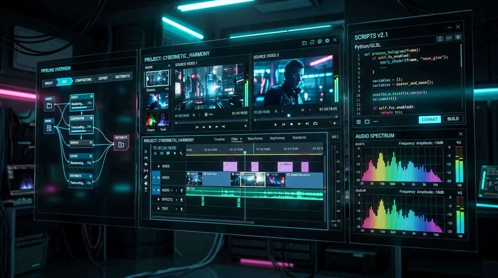
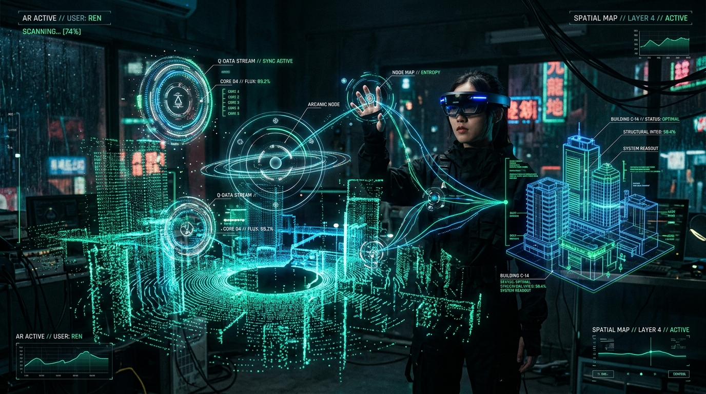
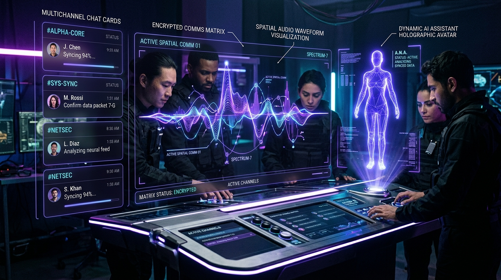
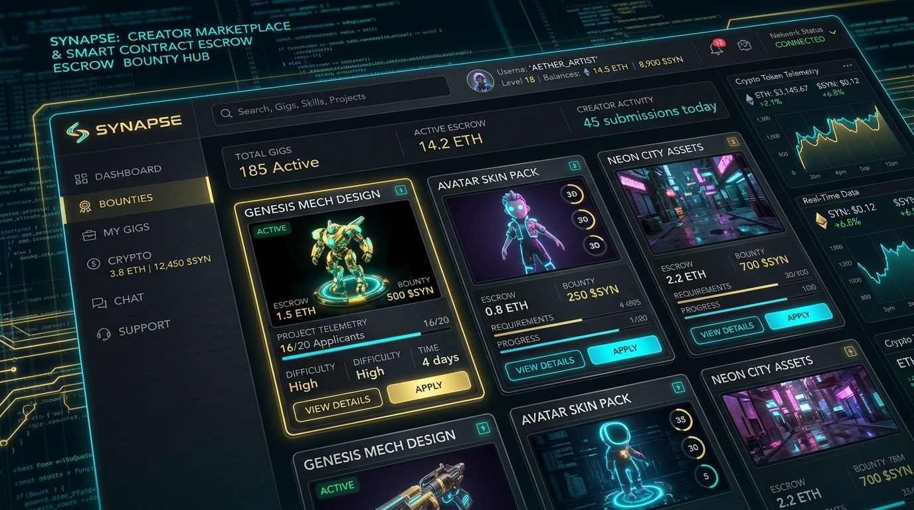
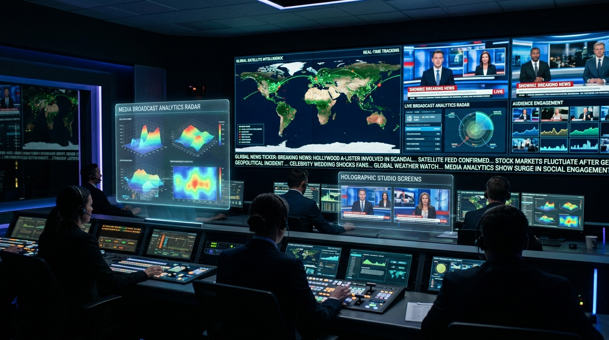
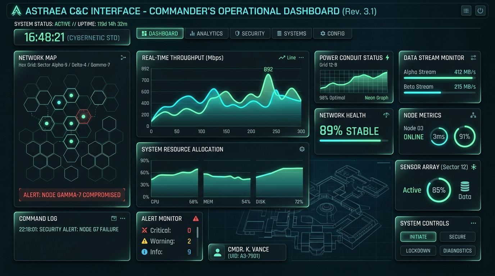
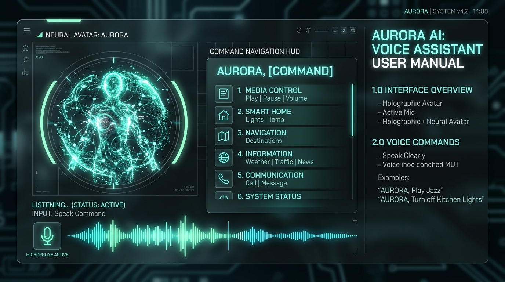
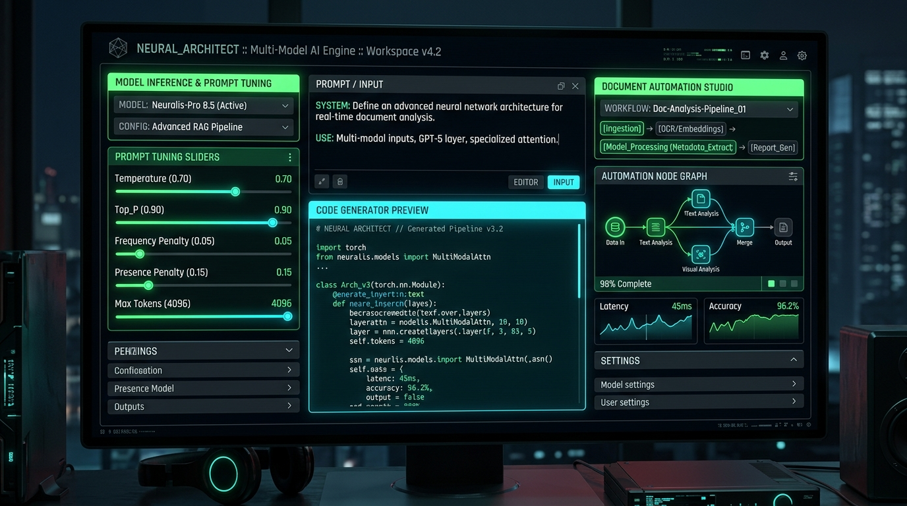
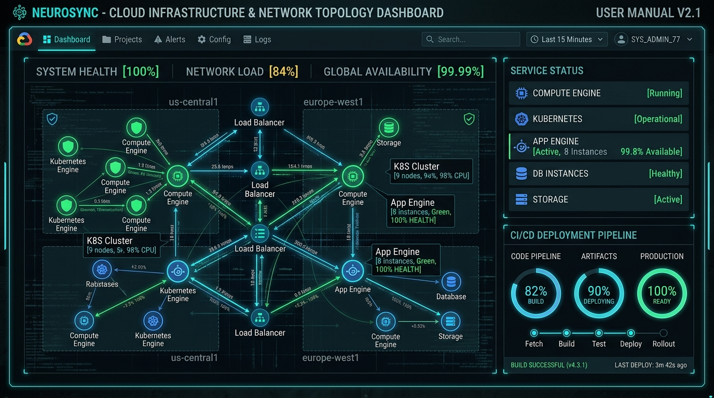

# Oistarian-NEXUS-ONE: Enterprise Command Ecosystem
> A hyper-advanced, AI-powered command center and autonomous operational ecosystem fusing real-time multi-model intelligence, microphone-driven voice navigation, cloud service orchestration, and automated business workflows.

[](https://www.bestpractices.dev/projects/10423)
[](https://securityscorecards.dev/viewer/?uri=github.com/oistars/oistarian-nexus-one)
[](./docs/OPENSSF_SECURITY.md)
[](./docs/PROGUARD_DOCUMENTATION.md)
[](./docs/PLAYSTORE_SYMBOLS.md)
[](./LICENSE)

---

## System Overview

**Oistarian-NEXUS-ONE** serves as a unified mission control platform engineered for developers, enterprise operators, and creators. It brings together multi-model AI synthesis, cloud infrastructure governance (Google App Engine, Cloud SQL, Vertex AI), real-time microservice topology maps, and hands-free voice command execution into a responsive, high-contrast cybernetic interface.

```
+-------------------------------------------------------------------------------+
|                             OISTARIAN-NEXUS-ONE                               |
|                            Global Mission Control                             |
+-------------------------------------------------------------------------------+
        |                       |                       |               |
        v                       v                       v               v
+---------------+       +---------------+       +---------------+ +-------------+
| Real-time HUD |       | Neural Voice  |       | Multi-Model   | | Cloud & GAE |
| Telemetry &   | <---> | Activation &  | <---> | AI Engine &   | | Topology    |
| Command Radar |       | Avatar Sync   |       | Architect     | | Services    |
+---------------+       +---------------+       +---------------+ +-------------+
```

---

## Content & Media Matrix: 5-Pillar Visual Showcase

Explore the 5 core content creation, collaboration, spatial computing, and intelligence terminals powered by the NEXUS-ONE engine:

### 1. Multimedia Content Matrix & Studio Pipeline
Unified multimedia editing station combining video track compositing, procedural GLSL shaders, multi-track audio spectrum visualization, and automated multi-channel publishing pipelines (Web, Social, RSS, CMS).



- **Timeline Compositing**: Real-time layer blending, transition keyframing, and video asset transcoding.
- **Audio Spectrum Engine**: Web Audio FFT visualizer with decibel amplitude readouts, VU peak meters, and spatial acoustic leveling.
- **Multi-Format Export**: Automated compilation into web bundles, video snippets, and markdown article feeds.

---

### 2. 3D Spatial Augmented Reality & LiDAR Canvas
Interactive holographic workspace rendering 1,400+ point-cloud particles, 6DoF parallax odometry, real-time node entropy analysis, and digital-twin building mesh overlays.



- **Optical LiDAR Scanner**: WebCam feed augmented with interactive depth particles and bounding telemetry sensors.
- **Quantum HoloCore**: 3D geometric gyro with rotating kinetic rings and real-time quaternion attitude telemetry.
- **Spatial Audio Synthesizer**: Binaural HRTF soundscapes linked to 3D spatial rotation coordinates.

---

### 3. Encrypted Comms Matrix & Collaboration Terminal
Mission-grade multi-channel collaboration suite with spatial voice channels, AI ghostwriting synthesis, encrypted telemetry chat cards, and real-time peer presence indicators.



- **Multi-Channel Rooms**: Instant switching across `#general-hq`, `#showbiz-buzz`, `#influencer-deals`, `#marketplace-bounties`, and `#dev-ops`.
- **Aura AI Ghostwriter**: 1-click intelligent responses, draft synthesis, and live conversation summaries.
- **Spatial Audio Voice Memos**: Interactive HRTF audio player with visual equalizer playback.

---

### 4. Creator Marketplace & Smart Contract Escrow Bounties
Decentralized creator economy hub featuring smart escrow bounty backing, 3D asset trade previews, influencer sponsorship bids, and milestone-gated payout settlements.



- **Smart Contract Escrow**: Secure milestone escrow simulation for freelance creator gigs and brand sponsorships.
- **Interactive Proposal Submissions**: Real-time bidding, quote submissions, and project delivery tracking.
- **Asset Telemetry**: Dynamic filtering across 3D Shaders, Character Skins, Audio Tracks, and Video Promos.

---

### 5. Daily News & Showbiz Intelligence Radar
Satellite intelligence and showbiz command deck delivering real-time streaming tickers, VIP celebrity analytics, media broadcast radars, and 30-second AI executive briefings.



- **Live Breaking Ticker**: Continuous animated satellite ticker monitoring global entertainment and tech milestones.
- **Showbiz & VIP Feed**: High-priority alert categorizations across Hollywood box office, awards, fashion, and digital media.
- **AI Bullet Briefings**: Automated 30-second executive summaries and 1-click social media broadcast sharing.

---

## User Manual & Core Interface Walkthrough

### Command Center & Telemetry Dashboard
The **Command Center** provides an immediate high-altitude operational summary of all active sub-systems, including live cluster health, throughput radars, priority alerts, and real-time execution pulses.



- **Throughput & Latency Gauges**: Instant visual telemetry across all backend relays and microservice nodes.
- **Unified Health Radars**: Continuous scanning of network integrity, active API tokens, and compute loads.
- **Quick-Switch Launchpad**: Rapid access bar for jumping straight to high-priority business operations.

---

### Avatar Sync & Voice Activation Listener
The **Avatar Sync & Voice Listener** enables hands-free vocal navigation and real-time neural persona modulation leveraging Web Speech Recognition and custom speech synthesis feedback.



- **Microphone HUD**: Click the glowing mic or press <kbd>Alt + V</kbd> to initiate voice commands.
- **Real-Time Soundwave Spectrum**: Instant visualization of audio frequency levels and confidence scoring.
- **Persona Swapping**: Switch between **Aura** (*Strategic & Calm*), **Nova** (*Dynamic & Precise*), and **Echo** (*Adaptive & Geometric*).

---

### Unified AI Engine & Neural Architect Studio
The **AI Engine** and **Neural Architect** provide an integrated environment for multi-model prompt experimentation, automated code scaffolding, document generation, and predictive business intelligence.



- **Model Orchestration**: Multi-model inference testing across Gemini Flash, Pro, and custom neural agents.
- **Scaffolding Engine**: Autonomous blueprints and full-stack software component generation.
- **Parameter Lab**: Precision control over temperature, top-k, and sampling limits.

---

### Cloud Parameters, App Engine & Topology Map
The **Cloud Configuration Hub** and **Topology Map** offer deep visibility into Google Cloud Platform services, App Engine deployment parameters, and dependency graphs.



- **GCP Services Manager**: Orchestrate App Engine Admin API, Cloud Source Repositories, and Cloud SQL.
- **Dependency Graph**: Interactive node cluster graphing depicting live service connectivity and latencies.

---

## Security Assurance & OpenSSF Compliance

Oistarian-NEXUS-ONE follows the **Open Source Security Foundation (OpenSSF)** Best Practices and SLSA Level 3 criteria:

- **OpenSSF Best Practices**: Passing verification for change control, vulnerability disclosure, code reviews, and dependency health. Read the full compliance matrix in [docs/OPENSSF_SECURITY.md](./docs/OPENSSF_SECURITY.md).
- **Vulnerability Disclosure Policy**: Formal SLA and Coordinated Vulnerability Disclosure (CVD) documented in [SECURITY.md](./SECURITY.md).
- **Software Bill of Materials (SBOM)**: Automated SPDX and CycloneDX bill-of-materials generation on every production build.
- **Zero Client Token Exposure**: All external credentials (`GEMINI_API_KEY`, Cloud SQL credentials) remain strictly server-side behind authenticated Express proxies.

---

## ProGuard & R8 Obfuscation Rules

Production Android, hybrid WebView, and mobile distributions are protected using rigorous ProGuard/R8 optimization and obfuscation rules:

- **Rules Configuration**: Located in [`proguard-rules.pro`](./proguard-rules.pro) and [`android/app/proguard-rules.pro`](./android/app/proguard-rules.pro).
- **5 Optimization Passes**: Aggressive dead-code elimination, bytecode repackaging, and symbol renaming.
- **Bridge Protection**: Retains `@JavascriptInterface` attributes, reflection signatures, `@Keep` annotations, and WebKit Chrome clients.
- **Crash Trace Retention**: Preserves `LineNumberTable` and `SourceFile` attributes to enable automated deobfuscation in Google Play Console.
- **Full Guide**: See [docs/PROGUARD_DOCUMENTATION.md](./docs/PROGUARD_DOCUMENTATION.md).

---

## Google Play Store Symbols & Deobfuscation

Ensure 100% deobfuscated crash traces and native call stacks in **Google Play Console** and **Android Vitals**:

- **Native Debug Symbols**: Unstripped NDK DWARF symbol packaging (`native-debug-symbols.zip`) supporting `arm64-v8a`, `armeabi-v7a`, and `x86_64`.
- **R8 Mapping File**: Automated `mapping.txt` generation via Gradle `bundleRelease`.
- **Automated Packager Script**: Execute [`scripts/package-playstore-symbols.sh`](./scripts/package-playstore-symbols.sh) to package symbols, mapping files, and SHA-256 checksums into `build/playstore-symbols/`.
- **Upload Guide**: Detailed step-by-step instructions for Play Console and Fastlane deployment in [docs/PLAYSTORE_SYMBOLS.md](./docs/PLAYSTORE_SYMBOLS.md).

---

## Voice Navigation Command Reference

| Spoken Trigger Phrase | Target Module | System Action |
| :--- | :--- | :--- |
| `"Go to dashboard"` / `"Open command center"` | **Command Center** | Opens primary system metrics and telemetry overview |
| `"Open AI engine"` / `"Switch to neural models"` | **AI Engine** | Launches multi-model prompt and inference matrix |
| `"Open cloud parameters"` / `"Show App Engine"` | **Cloud Parameters** | Displays Google Cloud APIs and infrastructure configs |
| `"Open topology map"` / `"Show dependency graph"` | **Topology Map** | Renders interactive microservices cluster visualizer |
| `"Go to smart inbox"` / `"Check priority notifications"`| **Smart Inbox** | Opens AI-categorized communications and alerts |
| `"Open deployment hub"` / `"Show CI CD pipeline"` | **Deployment Hub** | Manages releases, container metrics, and rollbacks |
| `"Open smart docs"` / `"Generate contract"` | **Smart Docs & Forms**| Accesses legal templates, NDAs, and automated invoices |
| `"Open marketing suite"` / `"Show SEO campaigns"` | **Marketing Suite** | Opens autonomous marketing and growth analytics |
| `"Open social control"` / `"Go to feeds"` | **Social Control** | Unified multi-channel social media dispatch |
| `"Open navigation system"` / `"Show GPS map"` | **Navigation System** | Global GPS waypoint routing and telemetry paths |
| `"Open AR interface"` / `"Switch to AR view"` | **AR Interface** | Launches spatial augmented reality holographic HUD |
| `"Open Google Sheets"` / `"Go to spreadsheets"` | **Google Sheets Hub** | Real-time Google Workspace sheets reader and telemetry exporter |
| `"Open collaboration"` / `"Go to comms room"` | **Collaboration Hub** | Opens team chat matrix, spatial memos, and marketplace |
| `"Open content matrix"` / `"Show media studio"` | **Content Matrix** | Opens multimedia studio, blog writer, and showbiz news |
| `"Open voice history"` / `"Show voice log"` | **Voice HUD** | Displays real-time voice activation telemetry and success feedback overlay |
| `"Set avatar to Nova"` / `"Change persona to Echo"` | **Avatar Sync** | Hot-swaps the active neural voice persona |
| `"Help"` / `"What can I say?"` | **Voice Modal** | Pops up the complete searchable Voice Reference Index |

---

## Technical Architecture & Setup

### Requirements
- **Node.js**: `v18.0.0+`
- **Package Manager**: `npm` or `bun`
- **Supported Browsers**: Chrome, Edge, Safari, Firefox (Web Speech API works best in Chromium-based browsers)

### Development Setup
```bash
# Clone the repository
git clone https://github.com/oistars/oistarian-nexus-one.git

# Install dependencies
npm install

# Start development server on port 3000
npm run dev
```

### Production Build & Packaging
```bash
# Compile client SPA and backend bundling
npm run build

# Package Google Play Store deobfuscation and native crash symbols
chmod +x scripts/package-playstore-symbols.sh
./scripts/package-playstore-symbols.sh

# Start production server
npm start
```

### Environment Configuration (`.env`)
```env
# Server-side Gemini API credentials
GEMINI_API_KEY=your_gemini_api_key_here
```

---

*Oistarian-NEXUS-ONE // Autonomous Command Architecture // Designed for Next-Generation Operators*
